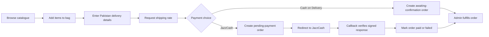

# Aromotive deployment architecture

Aromotive is packaged as a self-contained Docker Compose application with two services: an Express/Node.js application and PostgreSQL. The application serves the responsive storefront and the protected administration CRM from the same origin, avoiding cross-origin configuration in production. Product and CMS media are uploaded to a persistent application volume; PostgreSQL data and uploaded media each have named Docker volumes.

| Layer | Technology | Responsibility |
|---|---|---|
| Storefront and CRM | Semantic HTML, CSS, JavaScript | Catalogue, cart, checkout, journal, customer account, and secured content operations. |
| Application | Node.js 22, Express 5 | REST APIs, JWT administration authentication, order creation, uploads, JazzCash request signing, shipping estimates, static delivery. |
| Persistence | PostgreSQL 16 | Products, categories, images, banners, blogs, orders, customers, and admin users. |
| Media | Local persistent Docker volume | Uploaded banners, product images, and blog cover images. It can be replaced by S3-compatible object storage through the `STORAGE_DRIVER` interface. |
| Payments | JazzCash hosted-payment redirect | A server endpoint signs a transactional request using merchant secrets and sends the buyer to JazzCash. Callback handling updates payment state. |
| Shipping | Configurable carrier adapter | Checkout queries a courier-rate endpoint when configured; a transparent PKR fallback rule remains available for local development and outages. |

## Primary shopper flow

## Security and configuration

The administrative CRM requires a seeded or environment-created admin account and a signed JWT. Uploaded files are limited to JPEG, PNG, WebP, and GIF images and a 5 MB size. In production, `JWT_SECRET`, database credentials, JazzCash values, and courier credentials must be set through environment variables—never committed to source control. JazzCash credentials follow the hosted-payment documentation supplied by the merchant and are deliberately exposed only in backend configuration.

## Deployment model

Run `docker compose up --build -d` after copying `.env.example` to `.env`. PostgreSQL availability is checked by the application container before it starts. The bootstrap task creates tables and starter content only when the database is empty, allowing the deployed CRM to remain authoritative after launch.
